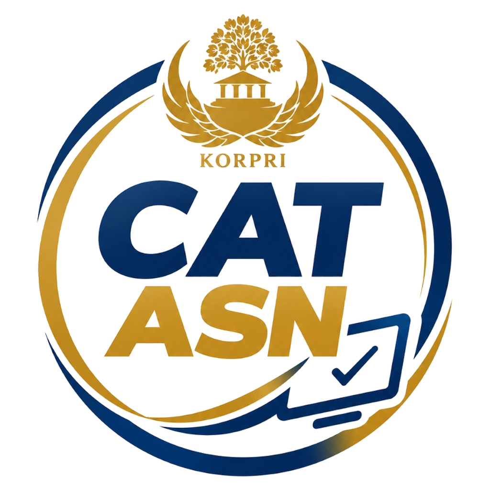
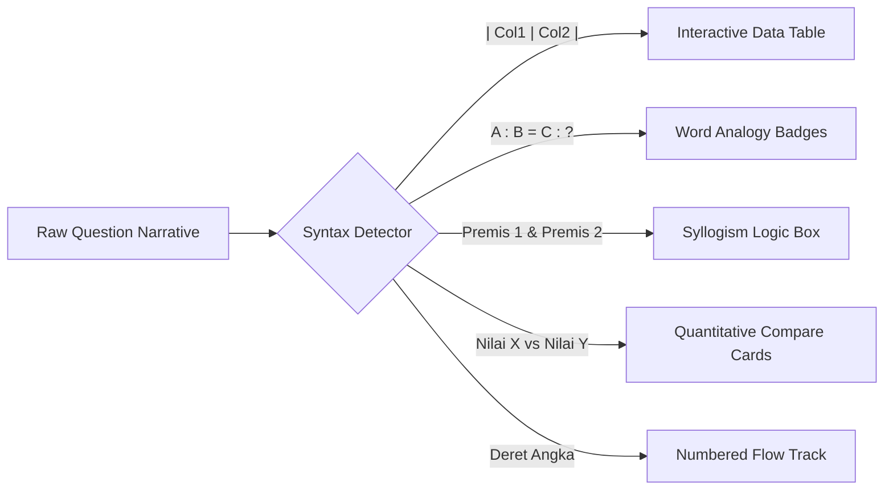

<p align="center">
  
</p>

<h1 align="center">CAT CASN 2027 SIMULATOR SYSTEM</h1>

<p align="center">
  <strong>Platform Simulasi Ujian Seleksi Calon Aparatur Sipil Negara (CPNS, PPPK, & Sekolah Kedinasan)</strong><br>
  Mengikuti Standar Resmi BKN Computer Assisted Test (CAT) • Dilengkapi Zero-Defect AI Question Engine & Modern Executive UI
</p>

<p align="center">
  <a href="https://laravel.com"></a>
  <a href="https://php.net"></a>
  <a href="https://mysql.com"></a>
  <a href="https://bkn.go.id"></a>
  <a href="https://groq.com"></a>
  <a href="#lisensi"></a>
</p>

---

## 🏛️ Ikhtisar Eksekutif

**CAT CASN 2027 Simulator System** adalah platform simulasi ujian seleksi pegawai negeri berbasis web modern yang dirancang untuk memberikan pengalaman ujian yang identik dengan sistem resmi **Computer Assisted Test (CAT) Badan Kepegawaian Negara (BKN)**.

Aplikasi ini dibangun menggunakan arsitektur enterprise Laravel 11, dilengkapi dengan komponen visualizer interaktif untuk format soal TIU terbaru (tabel komparasi, silogisme formal, analogi kata, perbandingan kuantitatif $X$ vs $Y$), generator soal berbasis AI dengan protokol anti-halusinasi (*Zero-Defect Reverse-Solving*), mesin audit kualitas bank soal otomatis, serta sistem navigasi ujian *fluid-motion* yang responsif pada layar ponsel maupun desktop.

---

## 🎯 Standar Penilaian Resmi BKN & PermenPAN-RB

Sistem ini mendukung secara *native* tiga jalur seleksi utama aparatur sipil negara:

### 1. SKD (Seleksi Kompetensi Dasar) — CPNS & Sekolah Kedinasan
Total **110 butir soal** dengan alokasi waktu **100 menit** (130 menit untuk penyandang disabilitas sensori netra).

| Materi Ujian | Jumlah Soal | Bobot Nilai | Passing Grade (Umum) | Ruang Lingkup Materi |
| :--- | :---: | :---: | :---: | :--- |
| **TWK (Tes Wawasan Kebangsaan)** | 30 Soal | Benar: +5<br>Salah: 0<br>Kosong: 0 | **65** | Nasionalisme, Integritas, Bela Negara, Pilar Negara (Pancasila, UUD 1945, NKRI, Bhinneka Tunggal Ika), Bahasa Indonesia, dan HOTS Studi Kasus Kebangsaan. |
| **TIU (Tes Intelegensia Umum)** | 35 Soal | Benar: +5<br>Salah: 0<br>Kosong: 0 | **80** | **Verbal:** Analogi Kata, Silogisme, Analitis.<br>**Numerik:** Berhitung, Deret Angka/Huruf, Perbandingan Kuantitatif ($X$ vs $Y$), Soal Cerita Data.<br>**Figural:** Analogi Gambar, Ketidaksamaan, Serial Gambar. |
| **TKP (Tes Karakteristik Pribadi)** | 45 Soal | Skala 1 s.d. 5<br>(Tidak Menjawab: 0) | **166** | Pelayanan Publik, Jejaring Kerja, Sosial Budaya, TIK, Profesionalisme, dan Anti-Radikalisme (Format Situational Judgement Test / SJT). |
| **TOTAL SKD** | **110 Soal** | **Maksimal: 550** | **Lulus PG** | Evaluasi kelulusan berbasis pemenuhan nilai ambang batas ketiga komponen secara simultan. |

### 2. SKB (Seleksi Kompetensi Bidang)
- **Komposisi Soal Berstandar Instansi**:
  - **30%**: Regulasi, Kebijakan Publik, dan Pengetahuan Umum Instansi Pembina.
  - **70%**: Kompetensi Khusus / Keahlian Teknis Jabatan Fungsional (misal: Pranata Komputer, Tenaga Medis/Farmasi, Analis Kebijakan, Guru, Auditor).
- Penilaian berbobot tunggal dengan opsi simulasi CAT BKN + Ujian Wawancara / Praktik Kerja.

### 3. PPPK (Pegawai Pemerintah dengan Perjanjian Kerja)
- **Kompetensi Teknis**: Ujian keahlian profesi spesifik.
- **Kompetensi Manajerial**: Integritas, kerjasama, komunikasi, orientasi pada hasil, pelayanan publik, pengembangan diri, mengelola perubahan, pengambilan keputusan.
- **Kompetensi Sosio-Kultural**: Kepekaan terhadap keberagaman suku, agama, dan budaya.
- **Wawancara Terintegrasi**: Penggalian integritas dan moralitas berbasis komputer (10 menit).

---

## 🔬 Format Visualizer Soal TIU 2027

Platform ini memiliki parser dua tingkat (PHP server-side via `QuestionDisplaySupport` dan Alpine.js client-side) untuk merender elemen format soal TIU tingkat lanjut secara otomatis:



### 1. 📊 Tabel Data Komparasi & Analisis
- Mendeteksi notasi tabel Markdown pipe (`| Kolom 1 | Kolom 2 |`) dan mengubahnya menjadi tabel interaktif.
- Mendukung fitur *sticky header*, garis kontras tinggi, sorotan baris (*hover state*), serta *horizontal swipe* yang mulus di perangkat mobile.

### 2. 🔗 Analogi Pasangan Kata
- Memformat hubungan kata terstruktur `A : B = C : [ ? ]` menjadi *chip badges* elegan dengan pemisah relasional yang jelas, mencegah teks bertumpuk atau salah tafsir pada layar kecil.

### 3. ⚖️ Silogisme Logika Formal
- Mengidentifikasi otomatis blok premis (`Premis 1`, `Premis 2`, `Premis 3`, atau `Semua / Sebagian`).
- Merender premis ke dalam kontainer berbingkai dengan penanda hierarki logika dan callout khusus untuk pengujian kesimpulan.

### 4. 📐 Perbandingan Kuantitatif ($X$ vs $Y$)
- Kartu metrik ganda yang memisahkan nilai variabel $X$ dan variabel $Y$ secara visual sebelum menampilkan hubungan opsi ($X > Y$, $X < Y$, $X = Y$, atau hubungan tidak dapat ditentukan).

### 5. 🔢 Deret Angka & Huruf
- Tampilan rangkaian nilai dalam kontainer berurutan dengan indikator target `?` yang menonjol untuk mempermudah identifikasi pola lompatan dan sub-deret.

---

## 🤖 AI Question Studio & Zero-Defect Engine

Modul pembuat soal pintar mengintegrasikan Large Language Model (LLM) dengan guardrail penjamin mutu:

- **Dual AI Provider**:
  - **Groq Cloud API**: Didukung model mutakhir **Llama 3.3 70B Versatile** dengan latensi generasi kurang dari 2 detik per paket soal.
  - **Ollama Local Engine**: Mendukung model lokal seperti **Qwen 2.5 Coder 7B**, **Mistral 7B**, atau **Llama 3.2** untuk operasional sepenuhnya *offline* tanpa biaya kuota API.
- **Zero-Defect Reverse-Solving Protocol**:
  - Algoritma AI terlebih dahulu menghitung dan memvalidasi jawaban yang benar secara matematis/faktual sebelum menyusun teks narasi soal dan opsi pengecoh (*distractor*). Hal ini mengeliminasi masalah umum kunci jawaban keliru (*hallucination*).
- **Generator Massal (Bulk Generator)**:
  - Fasilitas di `/admin/generate-bulk` untuk menghasilkan 5 hingga 50 soal sekaligus dengan validasi skema JSON ketat, opsi ekspor/impor SQL/CSV, dan integrasi otomatis ke subkategori bank soal.
- **PDF-to-Soal Extractor**:
  - Mesin konversi dokumen modul atau naskah latihan berformat PDF langsung menjadi butir soal terstruktur di database.
- **Question Quality Auditor**:
  - Mesin pemeriksa kesehatan bank soal di `/admin/audit-soal` untuk mendeteksi soal duplikat, opsi yang terlalu pendek/timpang, serta kunci jawaban di luar rentang A–E.

---

## ⚡ Fitur Engine Ujian Realtime

1. **Sinkronisasi Waktu Server & Klien**:
   - Penghitung mundur waktu ujian berbasis interval milidetik dengan validasi berkala ke server untuk mencegah manipulasi jam browser oleh peserta.
2. **Autosave Ganda (Dual-Layer Persistence)**:
   - Setiap pilihan jawaban disimpan secara instan ke `LocalStorage` browser dan dikirimkan via background `fetch` AJAX ke database. Jika terjadi pemadaman listrik, crash browser, atau koneksi terputus, peserta dapat melanjutkan tanpa kehilangan progres.
3. **Matriks Navigasi Soal**:
   - Palet nomor soal dengan indikator status: **Sudah Dijawab** (Hijau), **Ragu-Ragu** (Kuning), dan **Belum Dijawab** (Netral).
   - Dilengkapi *Quick Jump Drawer* untuk perangkat mobile agar penguji tidak perlu menggulir jauh ke bawah.
4. **Sistem Keamanan & Anti-Cheat**:
   - Deteksi perpindahan tab browser (*window blur detection*).
   - Peringatan batas pelanggaran otomatis sebelum ujian dihentikan paksa jika peserta mencoba membuka jendela pencarian di luar aplikasi.
5. **Kalkulasi & Pembahasan Instan**:
   - Begitu ujian diakhiri, sistem langsung memproses skor total, status kelulusan passing grade, peringkat nasional sementara, serta lembar evaluasi dan pembahasan lengkap tiap butir soal.

---

## 🎨 Desain & Arsitektur Antarmuka (Executive Glassmorphism)

Antarmuka dibangun dengan pendekatan **Anti-Slop Design** yang mengutamakan kenyamanan membaca dalam durasi ujian panjang:
- **Palet Warna Resmi**:
  - `KORPRI Deep Navy`: `#0b1e36` (Identitas kenegaraan, ketegasan, fokus)
  - `KORPRI Gold / Amber`: `#d4af37` / `#f59e0b` (Aksen prestisius dan kredibilitas)
  - `Surface Glass`: Lapisan kartu semi-transparan dengan *backdrop blur* presisi dan kontras teks lolos uji aksesibilitas WCAG AAA.
- **Fluid Layout**:
  - Desain tombol pilihan ganda berukuran ramah sentuhan (minimal 48px), navigasi keyboard untuk kenyamanan desktop, serta bebas dari efek visual artifisial yang mengganggu konsentrasi.
- **Mode Tampilan**:
  - Dukungan penuh *Dark Mode* (Latar gelap hemat daya) dan *Light Mode* (Kertas bersih ala dokumen kedinasan).

---

## 📂 Struktur Direktori Proyek

```
cat-cpns/
├── app/
│   ├── Http/Controllers/
│   │   ├── Admin/                # Manajemen Soal, Paket, Import, Audit, AI Generator
│   │   ├── UjianController.php   # Ruang Ujian, Autosave, Submit, & Hasil Ujian
│   │   └── RankingController.php # Leaderboard & Perankingan Nasional
│   ├── Models/
│   │   ├── Soal.php              # Model Bank Soal (Kategori, Bobot, Opsi, Kunci)
│   │   ├── Ujian.php             # Sesi Ujian Peserta
│   │   ├── ExamMode.php          # Konfigurasi Mode (SKD, SKB, PPPK)
│   │   └── QuestionAudit.php     # Riwayat Audit Kualitas Soal
│   ├── Services/
│   │   ├── AISoalService.php     # Engine Groq & Ollama dengan Reverse-Solving
│   │   ├── ExamSessionService.php# State Management Sesi Ujian
│   │   └── QuestionQualityService.php # Validasi Mutu Bank Soal
│   └── Support/
│       ├── QuestionDisplaySupport.php # Parser Tabel, Analogi, & Silogisme
│       └── ExamRankingSupport.php     # Algoritma Peringkat & Passing Grade
├── public/
│   ├── icons/
│   │   ├── cat-logo.png          # Logo Resmi CAT CASN Shield Badge (PNG)
│   │   ├── cat-logo.svg          # Logo Vektor CAT CASN (SVG)
│   │   └── favicon.png
├── resources/
│   └── views/
│       ├── admin/                # Dashboard Admin, Form Soal, AI Bulk Generator
│       ├── ujian/
│       │   ├── running.blade.php # Ruang Tes Realtime (Timer, Soal, Navigasi)
│       │   └── hasil.blade.php   # Lembar Hasil, Skor, & Pembahasan
│       └── layouts/              # Theme Executive Glassmorphism & Styles
├── routes/
│   └── web.php                   # Definisi Rute Web & API Endpoint Autosave
└── database/
    ├── migrations/               # Skema Tabel Database CAT
    └── seeders/                  # Seeder Kategori, Bank Soal Awal, & Akun Default
```

---

## 🛠️ Panduan Instalasi & Pengoperasian Lokal

### Prasyarat Sistem
- **PHP** >= 8.2 (Ekstensi aktif: `pdo_mysql`, `mbstring`, `openssl`, `tokenizer`, `xml`, `curl`, `gd`, `zip`)
- **Composer** >= 2.2
- **MySQL** >= 8.0 atau **MariaDB** >= 10.4
- **Node.js** >= 18.x & NPM (Opsional untuk build Vite)
- Web Server: **Laragon** (Direkomendasikan di Windows) atau **Nginx / Apache**

### Langkah Pemasangan

1. **Clone Repositori**:
   ```bash
   git clone https://github.com/Arius2025/CAT2025.git
   cd CAT2025
   ```

2. **Instal Dependensi PHP**:
   ```bash
   composer install --no-dev --optimize-autoloader
   ```

3. **Konfigurasi Environment**:
   Salin file konfigurasi contoh dan buat file `.env`:
   ```bash
   cp .env.example .env
   ```

4. **Konfigurasi Database & API**:
   Buka file `.env` dan sesuaikan parameter berikut:
   ```env
   APP_NAME="CAT CASN 2027"
   APP_ENV=local
   APP_KEY=
   APP_DEBUG=true
   APP_URL=http://localhost:8000

   DB_CONNECTION=mysql
   DB_HOST=127.0.0.1
   DB_PORT=3306
   DB_DATABASE=cat_cpns
   DB_USERNAME=root
   DB_PASSWORD=

   # Konfigurasi AI Generator (Opsional)
   GROQ_API_KEY=gsk_your_groq_api_key_here
   GROQ_MODEL=llama-3.3-70b-versatile
   OLLAMA_HOST=http://127.0.0.1:11434
   ```

5. **Generate Kunci Aplikasi**:
   ```bash
   php artisan key:generate
   ```

6. **Jalankan Migrasi & Data Seeder**:
   ```bash
   php artisan migrate --seed
   ```

7. **Buat Tautan Simbolik Penyimpanan**:
   ```bash
   php artisan storage:link
   ```

8. **Jalankan Server Lokal**:
   ```bash
   php artisan serve
   ```
   Akses aplikasi di browser melalui: `http://127.0.0.1:8000`

---

## 🔐 Kredensial Akun Bawaan (Default Seeder)

Setelah proses `db:seed` selesai, akun berikut dapat langsung digunakan untuk uji coba:

| Role | Email | Password | Hak Akses |
| :--- | :--- | :--- | :--- |
| **Super Admin** | `admin@cat-cpns.test` | `password` | Akses penuh bank soal, generate AI, kelola paket ujian, audit sistem, dan pengaturan user. |
| **Peserta Ujian** | `peserta@cat-cpns.test` | `password` | Mengikuti simulasi ujian, melihat leaderboard, riwayat tes, dan pembahasan soal. |

*(Harap segera mengganti kata sandi bawaan pada instalasi server produksi).*

---

## 🌐 Panduan Deployment Server Produksi (VPS / CloudPanel)

Untuk menerapkan aplikasi pada server VPS (Ubuntu 22.04 / 24.04 LTS) dengan Nginx dan PHP-FPM:

1. **Direktori Web Server**:
   Arahkan root direktori Nginx ke folder `/public`:
   ```nginx
   server {
       listen 80;
       server_name cat.domainanda.my.id;
       root /home/user/htdocs/cat.domainanda.my.id/public;

       index index.php index.html;
       charset utf-8;

       location / {
           try_files $uri $uri/ /index.php?$query_string;
       }

       location ~ \.php$ {
           fastcgi_pass unix:/var/run/php/php8.2-fpm.sock;
           fastcgi_param SCRIPT_FILENAME $realpath_root$fastcgi_script_name;
           include fastcgi_params;
       }

       location ~ /\.(?!well-known).* {
           deny all;
       }
   }
   ```

2. **Izin Direktori**:
   ```bash
   chown -R www-data:www-data storage bootstrap/cache
   chmod -R 775 storage bootstrap/cache
   ```

3. **Optimasi Cache Laravel**:
   ```bash
   php artisan config:cache
   php artisan route:cache
   php artisan view:cache
   ```

---

## 📜 Lisensi

Proyek ini dilisensikan di bawah lisensi **MIT License**. Hak cipta bebas digunakan untuk keperluan edukasi, pelatihan bimbel kedinasan, maupun pengembangan simulator kepegawaian mandiri.

---

<p align="center">
  Dikelola dengan integritas dan standar profesionalisme aparatur sipil negara.<br>
  <strong>CAT CASN 2027 Simulator Team</strong>
</p>
